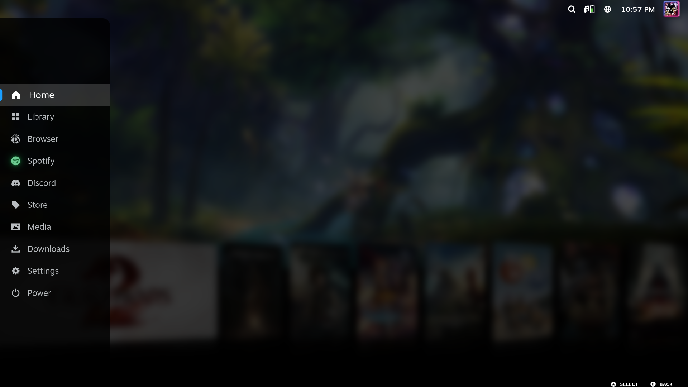
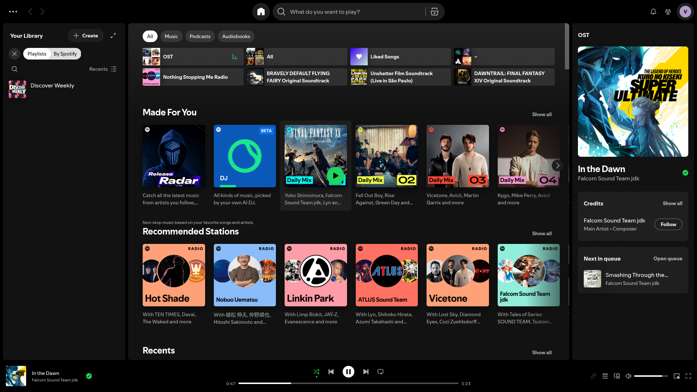
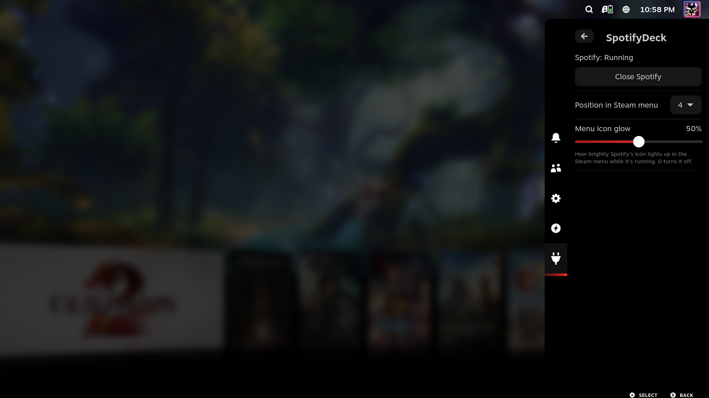

# SpotifyDeck

Adds **Spotify** to the Steam menu in Gaming Mode. It opens the Spotify flatpak (`com.spotify.Client`, installed from Discover in Desktop Mode) without adding it to your library as a non-Steam game.

- Pick **Spotify** in the Steam menu to open it. It starts Spotify first if it isn't running yet.
- Press the Steam button and pick anything else to go back to Steam. Spotify keeps playing in the background.
- Highlight Spotify in the Steam menu and press X to close it, or use Close Spotify in the Quick Access menu.
- While Spotify runs, its icon in the Steam menu lights up green, and Audio Loader's menu music pauses.

## Quick Access menu

- **Close Spotify** (shown while Spotify is running)
- **Position in Steam menu**: where Spotify sits, counting every entry in the menu
- **Menu icon glow**: how brightly the icon lights up while Spotify is running (0% turns it off)

## How it works

Gaming Mode's compositor (gamescope) only shows windows that belong to an app Steam launched. The plugin's backend starts Spotify in your user session and tags its window with a placeholder app ID. While Steam is on the plugin's Spotify page, the backend asks gamescope to show that window. When Steam navigates away, or brings a game to the front, it hands the screen back to Steam.

## Requirements

- Decky Loader 3 or newer
- Spotify installed from Discover (Flathub `com.spotify.Client`)

## Credits

The Steam menu patch is adapted from [DeckWebBrowser](https://github.com/jessebofill/DeckWebBrowser) by Jesse Bofill (GPL-3.0).

## License

GPL-3.0
